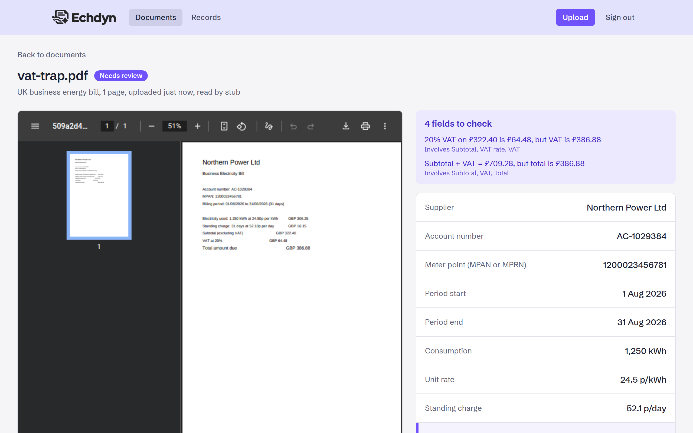
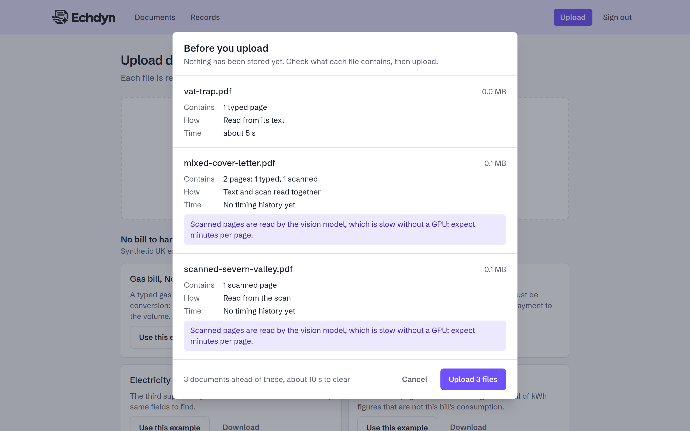
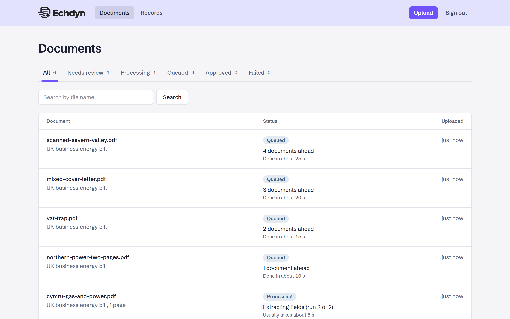
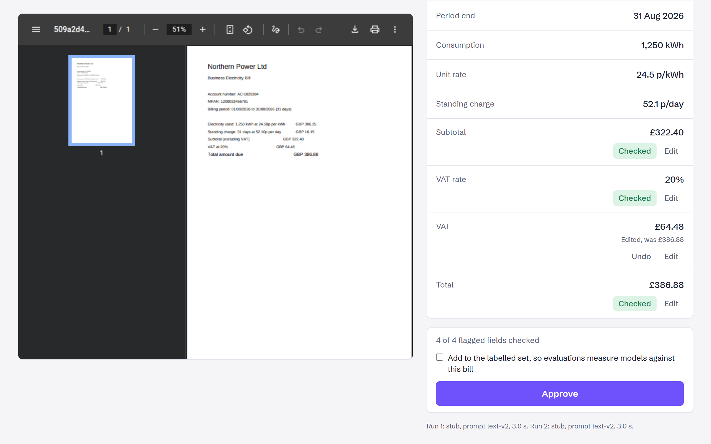
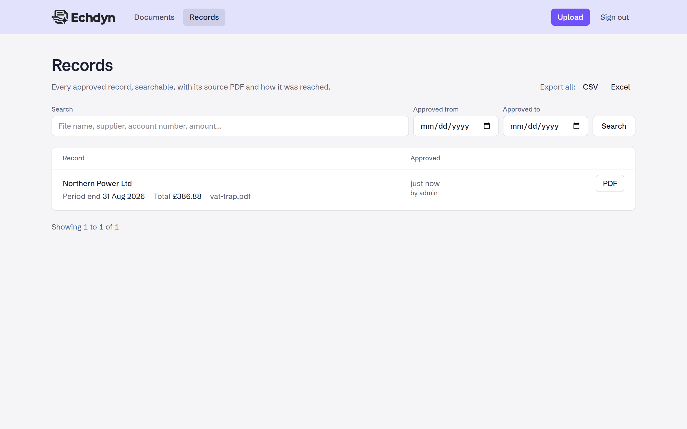
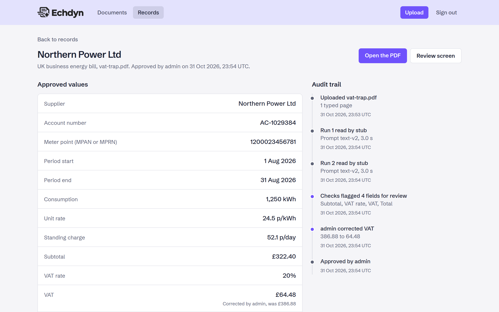
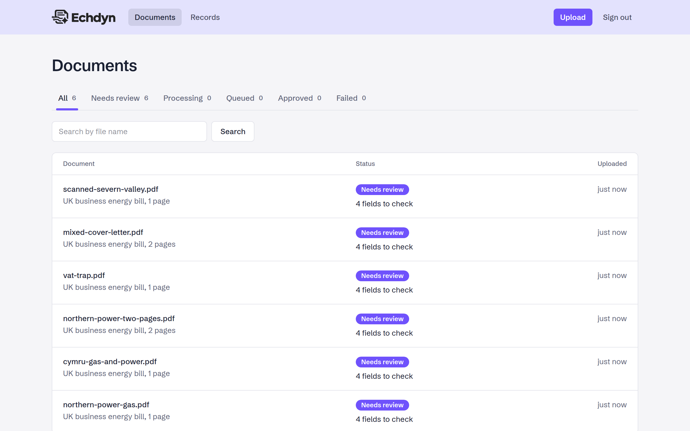

<p align="center">
  <picture>
    <source media="(prefers-color-scheme: dark)" srcset="apps/web/public/echdyn-logo-white.webp">
    
  </picture>
</p>

# echdyn

Self-hosted document extraction with local LLMs: PDFs and scanned paperwork in, validated and audited structured data out, without anything leaving your own hardware.

echdyn (from the Welsh _echdynnu_, "to extract", said "ECH-din" with the ch as in "loch") reads each upload with a model running in Ollama, checks the result against business rules, sends anything uncertain to a human reviewer, and publishes approved records through a REST API, signed webhooks and CSV or Excel exports.

**[See the showcase site](https://phoenix1331.github.io/echdyn/)** for a tour of the screens and results.



## What this demonstrates

Plenty of businesses still pay people to retype supplier PDFs into an ERP, and many of them will not send contracts, patient letters or quality data to a cloud API. echdyn is a working answer to both problems, and a study in how to make a small, local model trustworthy enough to use.

| Concept                                     | How echdyn does it                                                                                                                                                                                                    |
| ------------------------------------------- | --------------------------------------------------------------------------------------------------------------------------------------------------------------------------------------------------------------------- |
| **Structured output from a local model**    | The document type's schema goes to Ollama as JSON Schema in the `format` field, so the model is grammar-constrained to return JSON in that shape                                                                      |
| **Copy, then parse in code**                | The model copies values exactly as printed (`£1,526.95`, `18.3p`, `10 February 2026`); deterministic code converts them. Small models are good at reading and bad at arithmetic and reformatting                      |
| **Checks a model cannot talk its way past** | The demo document is the UK business energy bill because its figures add up: consumption x unit rate + standing charge = subtotal, subtotal + VAT = total. Zod validates the shape, business rules validate the maths |
| **Self-consistency scoring**                | Every document is extracted twice, at temperature 0 and 0.4. Fields that change between runs are ones the model is unsure about, so they are flagged                                                                  |
| **Human in the loop**                       | Clean documents can be auto-approved; flagged ones land in a review screen with the PDF beside the fields and the reason for each flag                                                                                |
| **Accuracy measured, not claimed**          | An eval harness runs the real pipeline over labelled sets and reports per-field accuracy, review rate and, most importantly, how many wrong documents slipped through unflagged                                       |
| **Text, scans and mixed PDFs**              | Each page is classified as text, scan or blank. Text pages are read by a text model, scanned pages are rendered to PNG and read by a vision model, and mixed documents send both in one request                       |
| **Full audit trail**                        | Every approved value traces back to its source PDF, the model run that produced it (model, prompt version, raw output) and any reviewer correction                                                                    |
| **Reliable delivery**                       | BullMQ jobs with retries and backoff, idempotent uploads by SHA-256, and webhooks written to an outbox inside the approval transaction, then signed and retried                                                       |

## Screenshots

| Upload with a pre-flight summary                                                   | Live progress                                                                      |
| ---------------------------------------------------------------------------------- | ---------------------------------------------------------------------------------- |
|                                   |  |
| **Review and correct**                                                             | **Approved records**                                                               |
|            |                                 |
| **Audit trail**                                                                    | **Document list**                                                                  |
|  |                        |

The screenshots are generated, not hand-taken: `make screenshots` uploads the bundled `examples/` to a fresh isolated stack and captures them with Playwright, so anyone can reproduce them.

## Tech stack

| Layer        | Choice                                                                                                                                               |
| ------------ | ---------------------------------------------------------------------------------------------------------------------------------------------------- |
| Language     | TypeScript (strict) throughout, Node 24, pnpm workspace                                                                                              |
| Web, API     | Next.js 16 App Router: UI pages and REST route handlers in `apps/web`                                                                                |
| Worker       | Node (`tsx`) BullMQ consumer in `apps/worker`                                                                                                        |
| Shared core  | `packages/core`: config, schema, storage, queue, pipeline, extraction, eval                                                                          |
| Queue        | BullMQ on Redis 8                                                                                                                                    |
| Database     | Postgres 18, Drizzle ORM, JSONB with GIN indexes                                                                                                     |
| File storage | S3 API: RustFS locally, AWS S3 in production                                                                                                         |
| LLM runtime  | Ollama, via the `ollama` npm package                                                                                                                 |
| Schemas      | Zod 4, converted with the built-in `z.toJSONSchema`                                                                                                  |
| PDF handling | pdfjs for text and page classification, `@napi-rs/canvas` for rendering scans                                                                        |
| Exports      | CSV and Excel (`.xlsx`)                                                                                                                              |
| Quality      | Vitest with v8 coverage (90% line minimum), Playwright end to end, ESLint (`typescript-eslint` strict), Prettier, `tsc --noEmit`, osv-scanner, Husky |
| Packaging    | Docker Compose                                                                                                                                       |

## Getting started

### Prerequisites

- Docker with Docker Compose
- Node 24 and pnpm on the host (via `corepack enable`), only to install the git hooks
- [osv-scanner](https://github.com/google/osv-scanner) for the pre-commit dependency audit: `go install github.com/google/osv-scanner/cmd/osv-scanner@latest`
- Enough memory for a model: a 3B text model runs on a CPU-only machine with 8 GB of RAM; scans need a vision model and are far quicker on a GPU (point `OLLAMA_HOST` at a GPU machine to use one)

Run `pnpm install` once on the host after cloning. It activates the Husky hooks (`commit-msg` enforces lowercase Conventional Commits; `pre-commit` runs lint, typecheck and osv-scanner). Everything else runs inside the containers.

### Run it

1. `cp .env.example .env` and change the admin credentials and secrets if the app will be reachable from anywhere but localhost
2. `make up` starts Postgres, Redis, RustFS, Ollama, the web app and the worker
3. `make migrate` creates the tables
4. `make seed` registers the UK energy bill document type
5. `make models` pulls `OLLAMA_TEXT_MODEL` and `OLLAMA_VISION_MODEL` into Ollama
6. Open [http://localhost:8000](http://localhost:8000), sign in with `ADMIN_USERNAME` / `ADMIN_PASSWORD`, and upload a bill from `examples/` (each one tests something different, see `examples/README.md`)

### Makefile

`make help` lists every target.

| Target                                    | Does                                                                                                 |
| ----------------------------------------- | ---------------------------------------------------------------------------------------------------- |
| `up` / `down` / `restart` / `ps` / `logs` | Start, stop, restart, inspect and tail the stack                                                     |
| `build` / `install`                       | Rebuild the image, reinstall workspace dependencies in the containers                                |
| `shell`                                   | Shell in the `web` container                                                                         |
| `migrate` / `seed` / `fresh`              | Migrations, seed data, drop and rebuild                                                              |
| `models`                                  | Pull the configured text and vision models                                                           |
| `lint` / `typecheck`                      | Prettier and ESLint, `tsc --noEmit`                                                                  |
| `test` / `coverage`                       | Vitest, with the 90% coverage gate                                                                   |
| `e2e`                                     | Playwright review flow on an isolated stack with a stub model                                        |
| `screenshots`                             | Regenerate `docs/images/`                                                                            |
| `eval-generate` / `eval`                  | Regenerate the labelled sets, measure accuracy (`MODELS=a,b`, `VISION_MODEL=m`, `LIMIT="scanned=5"`) |

## Environment variables

All live in `.env` (copied from `.env.example`). Each is validated with Zod at start-up, so a bad value stops the app with a readable error.

| Key                                                   | Default                       | Description                                                           |
| ----------------------------------------------------- | ----------------------------- | --------------------------------------------------------------------- |
| `APP_PORT`                                            | `8000`                        | Host port for the web app                                             |
| `POSTGRES_PORT`                                       | `5432`                        | Host port for Postgres                                                |
| `REDIS_PORT`                                          | `6379`                        | Host port for Redis                                                   |
| `S3_PORT` / `S3_CONSOLE_PORT`                         | `9000` / `9001`               | Host ports for RustFS (S3 API and console)                            |
| `OLLAMA_PORT`                                         | `11434`                       | Host port for Ollama                                                  |
| `POSTGRES_USER` / `POSTGRES_PASSWORD` / `POSTGRES_DB` | `echdyn`                      | Postgres credentials and database                                     |
| `S3_BUCKET`                                           | `echdyn-documents`            | Bucket for original files and rendered pages, created on start-up     |
| `S3_REGION`                                           | `us-east-1`                   | S3 region                                                             |
| `S3_ACCESS_KEY` / `S3_SECRET_KEY`                     | `echdyn` / `echdyn-secret`    | S3 credentials                                                        |
| `S3_PUBLIC_ENDPOINT`                                  | `http://localhost:9000`       | Host the browser uses for signed PDF links                            |
| `OLLAMA_HOST`                                         | `http://ollama:11434`         | Ollama URL; point at another machine to use its GPU                   |
| `OLLAMA_TEXT_MODEL`                                   | `qwen3:8b`                    | Model for text pages                                                  |
| `OLLAMA_VISION_MODEL`                                 | `qwen2.5vl:7b`                | Model for scanned pages                                               |
| `OLLAMA_TIMEOUT_MS`                                   | `1800000`                     | Longest a single model call may take                                  |
| `OLLAMA_MAX_LOADED_MODELS`                            | `1`                           | Models Ollama keeps in memory at once                                 |
| `AUTO_APPROVE`                                        | `true`                        | Approve documents with no flagged fields without review               |
| `ADMIN_USERNAME` / `ADMIN_PASSWORD`                   | `admin` / `change-me-locally` | The single admin login (password 12+ characters)                      |
| `API_TOKEN`                                           | local placeholder             | Bearer token for the REST API, 32+ characters                         |
| `SESSION_SECRET`                                      | local placeholder             | Signs session cookies, 32+ characters; changing it signs everyone out |

Generate secrets with `openssl rand -hex 32`. Containers always talk to each other on the default internal ports; the port variables only change what is published on the host.

## API

Every endpoint takes `Authorization: Bearer <API_TOKEN>` (the UI uses a signed session cookie instead). `request.http` has a ready-made request for each one, including the error cases, for the VS Code REST Client or JetBrains HTTP Client. Errors share one shape: `{ "error": { "code", "message" } }`.

| Method         | Path                           | Purpose                                                                                                 |
| -------------- | ------------------------------ | ------------------------------------------------------------------------------------------------------- |
| `GET`          | `/api/health`                  | Liveness check                                                                                          |
| `POST`         | `/api/documents/inspect`       | Dry run: page kinds, which model reads it, time estimate, duplicates, queue. Nothing stored             |
| `POST`         | `/api/documents`               | Upload a PDF (multipart `file`, `document_type`); `201` queued, or `200` with `duplicate: true`         |
| `GET`          | `/api/documents`               | Documents with `status`, `type`, `q`, `page`, `page_size`                                               |
| `GET`          | `/api/documents/:id`           | Status, current stage, queue position and time estimate                                                 |
| `GET`          | `/api/records`                 | Approved records with search, date range and typed field filters such as `filter=unit_rate_pence:gt:30` |
| `GET`          | `/api/records/:id`             | One record with its extraction and corrections: the audit trail                                         |
| `GET`          | `/api/records/export`          | CSV (default) or `format=xlsx`, same filters as `/api/records`                                          |
| `POST` / `GET` | `/api/webhooks`                | Add an endpoint (the signing secret is shown once), list endpoints with delivery counts                 |
| `POST`         | `/api/webhooks/:id/ping`       | Send a signed test event                                                                                |
| `GET`          | `/api/webhooks/:id/deliveries` | The latest deliveries: status, attempts, last response                                                  |
| `DELETE`       | `/api/webhooks/:id`            | Deactivate an endpoint, keeping its log                                                                 |

Webhooks are signed Stripe-style: `Echdyn-Signature: t=<unix>,v1=<HMAC-SHA256 of "t.body">`, with `Echdyn-Event` and `Echdyn-Delivery` headers. Receivers should compare in constant time and reject old timestamps; `verifyWebhookSignature()` in `packages/core` does both.

## Evaluation results

Measured with `make eval` against 30 synthetic text bills across three supplier layouts and 5 scanned bills. Full tables, including accuracy per field and per layout, are in [`eval/results.md`](eval/results.md).

> [!NOTE]
> These are baseline numbers from a laptop: CPU only, no GPU, 8 GB of RAM and 4 CPU cores available to WSL. That hardware limits both columns that look weakest. **Latency** is slow because every token is generated on the CPU, and each scan takes over five minutes. **Accuracy** is limited because only 3B models fit in memory: the configured defaults (`qwen3:8b` for text, `qwen2.5vl:7b` for scans) would not load. The eval will be rerun on a home server with a GPU and those larger models, and the results added here for comparison. The scanned set is also small (5 bills), so its percentages move a lot with each document.

| Text model    | Vision model | Field accuracy | Documents fully correct | Flagged for review | Auto-approved with an error | Median latency |
| ------------- | ------------ | -------------- | ----------------------- | ------------------ | --------------------------- | -------------- |
| llama3.2 (3B) | qwen2.5vl:3b | 96.2%          | 62.9%                   | 40.0%              | 0 of 21                     | 33.3 s         |

| Set         | Read by      | Field accuracy | Fully correct | Flagged | Median latency |
| ----------- | ------------ | -------------- | ------------- | ------- | -------------- |
| Text (30)   | llama3.2     | 96.7%          | 66.7%         | 33.3%   | 32.5 s         |
| Scanned (5) | qwen2.5vl:3b | 93.3%          | 40.0%         | 80.0%   | 334.8 s        |

The column that matters is **auto-approved with an error**: documents that passed every check but still held a wrong value, the mistakes nobody would ever see. It is zero. Every error the model made was caught and sent to review, which is the property that makes a 3B model usable at all. Latency covers the whole pipeline, including both extraction runs.

Prompts improved through the eval rather than by guesswork. The first text run scored 84.2%: the model would not convert £/kWh rates to pence, squeezed `1,526.95` into `1.52695` under number-constrained decoding, and took the MPAN as the account number. Asking it to copy values as printed and parsing them in code took it to 96.7%. The first vision run scored 73.3% because dates were scrambled while being reformatted; the same fix took it to 93.3%.

The same harness runs on your own documents: drop labelled PDFs into `eval/sets/private/` (gitignored) and compare models before trusting one with your paperwork.

## Architecture notes

```
upload ──> ingest ──> pre-process ──> extract x2 ──> validate ──> score ──┬──> auto-approve ──> record ──> webhooks
           (hash,     (text, scan     (Ollama,       (Zod +       (flag   │
            store,     or blank per    JSON Schema)   arithmetic)  diffs)  └──> needs review ──> human ──> record ──> webhooks
            queue)     page)
```

| Path            | Role                                                                                                                    |
| --------------- | ----------------------------------------------------------------------------------------------------------------------- |
| `apps/web`      | Next.js UI (documents, upload, review, records, login) and thin REST route handlers                                     |
| `apps/worker`   | BullMQ consumers for the document pipeline and webhook deliveries                                                       |
| `packages/core` | Everything else: the pipeline, extraction, validation, storage, queue, webhooks and eval, with no dependency on Next.js |
| `eval/`         | Labelled sets and results                                                                                               |
| `examples/`     | Ready-to-upload bills, each probing a known trap                                                                        |
| `e2e/`          | Playwright specs and a stub Ollama for deterministic runs                                                               |

**The pipeline lives in `core`, not the worker.** The worker only maps BullMQ attempts onto retry or fail. That is why the eval harness can run the exact production stages, temperatures and rules over a labelled set without Redis, and why the tests can inject a fake chat client.

**Consistency is not correctness.** The two-run check catches uncertainty, but in testing llama3.2 misread VAT as the total identically in both runs. Only the arithmetic rules caught it. Scoring and validation each catch failures the other misses, which is why both exist.

**Bad output is data, not an exception.** If the model returns unparseable JSON it is stored with its raw output and goes to review. Only infrastructure failures (Ollama down, model missing) throw and trigger a retry, so a quality problem never burns retries.

**Document types are configuration.** A type is a versioned Zod schema plus extraction hints and business rules, stored as JSON Schema in `document_types`. Every extraction runs against the stored version it was queued with, and Postgres JSONB means one set of tables serves every type. Field filters in the API are checked against the type's schema, so `supplier:gt:a` is rejected with a reason.

**Idempotent from upload to webhook.** Files are content-addressed by SHA-256 and a unique `(document_type_id, sha256)` index is the real duplicate guard, so concurrent identical uploads resolve to one document. BullMQ job ids are document ids, records insert with `ON CONFLICT DO NOTHING`, and webhook deliveries are written in the same transaction as the approval (an outbox) so a crash can never approve a record without telling anyone.

**Local first, GPU optional.** The whole stack starts with one `make up`, Ollama included. Setting `OLLAMA_HOST` points it at a GPU machine instead, and storage only speaks the S3 API, so production swaps RustFS for AWS S3 with configuration alone.

**Tested at both ends.** Vitest covers `apps/*/src` and `packages/*/src` at a 90% line minimum against real Postgres and Redis. `make e2e` runs the review flow in Playwright on an isolated Compose project with its own database and a stub model that replays a real llama3.2 mistake, so the bill always lands in review in seconds and dev data is never touched.
